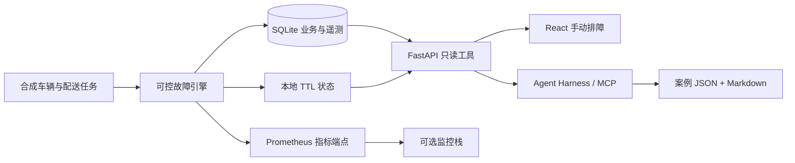

# 架构与设计取舍

## 业务主线

配送任务 → 站点运力筛选 → 路线/电量准入 → 派单决策 → 事件与遥测 → 分析与告警 → 人工或 Agent 排查 → 恢复验证 → 案例。

## 数据模型

| 表 | 粒度与含义 | 核心关联键 |
| --- | --- | --- |
| stations | 站点维表 | station_id |
| vehicles | 当前车辆状态；真实在线与业务可调度分开 | vehicle_id, station_id |
| tasks | 一条配送任务，状态 completed / timeout / queued | task_id, vehicle_id, trace_id |
| telemetry | 每车每五分钟历史遥测，运行时每分钟写入 | event_id, vehicle_id, event_time, ingest_time |
| dispatch_attempts | 一次调度决策及拒绝原因 | task_id, trace_id |
| logs | 服务事件日志 | station_id, trace_id, event_time |
| config_audit | 历史配置变更前后值 | station_id, config_key, event_time |
| metric_history | 站点分钟指标 | station_id, event_time |
| alerts | 工单生命周期 | alert_id, station_id |

时间统一存 Unix 秒，界面显示 Asia/Shanghai。默认基线从 2026-11-07 12:00 开始，用按钮推进模拟时间，不代表当前真实时钟。300 辆车 × 288 个五分钟采样 × 14 天 = 1,209,600 条历史遥测。站点坐标仅为示意合成点位。

派单成功率是本分钟接受任务数 / 尝试任务数。每站点每分钟模拟 10 个新任务；一辆符合条件的车提供一份本分钟容量。演示恢复时会额外处理一批积压，这是简化的恢复队列模型，不是实际配送调度优化器。

历史任务支持按天统计完成率、日环比与上周同日；当前窗口仅在故障运行后形成，因此不能将一分钟派单指标直接与历史配送完成率比较。

## 技术栈为何这样选

公开材料说明美团其他业务有 Kafka、Flink、Doris 的数仓实践，可作为技术选型参考；不能据此断言无人车内部使用相同部署。

- [美团实时数仓建设实践](https://tech.meituan.com/2021/08/26/Data-Warehouse-in-meituan-waimai.html)：分层、数据时效与统一指标。
- [Doris 在美团外卖数仓的应用](https://tech.meituan.com/2020/04/09/Doris-in-meituan-waimai.html)：明细分析、实时写入、业务查询。
- MySQL 负责事务对象，Redis 负责短期状态，Kafka 解耦事件流，Flink 做事件时间处理，Doris 支撑明细与聚合分析。
- Prometheus 用于数值指标，结构化日志用于解释单次决策；trace_id 跨任务与服务事件关联。

Lite 通过 SQLite 降低面试环境门槛。Full lab 提供真实组件复制链路和 Java 查询服务，不把本地缓存伪装成 Redis，不把 SQLite 伪装成 Doris。

## Agent 迁移方法

复用的是通用能力：对象分类、历史检索、假设选择、只读工具、证据验证、案例沉淀。替换的是领域实体、表结构、业务接口、配置含义与知识模式。

工具执行层强制：白名单、只读连接、SQL authorizer、3 秒执行超时、200 行输出限制、当前站点与事件时间的数据副本、每个 case 独立运行上下文。现场发生变化时诊断停止，避免把不同时间的证据混成一个结论。

不自动改写正式 SOP。案例先作为候选知识；人工复核后才进入通用模式。模型可以自由选择白名单工具和追加查询，确定性回放仅用于稳定展示与无凭证环境。

## 当前简化与后续工作

- 没有真实车辆控制、驾驶算法、地图服务或远程接管。
- Lite 日志是程序运行生成；trace_id 是业务关联，不声称已有分布式 OTel Span/Collector。可在 Java/Python 服务中补接 OTel Collector。
- 沙箱告警使用模拟分钟；可选 Prometheus 的 `for: 15s` 使用墙上时钟，两者时间语义不同。
- Full lab 是扩展验证配置，未实现生产 CDC、端到端 exactly-once 或正式权限系统。
- 当前模型执行上限控制轮数；全局 token 成本预算、运行队列与实时取消可继续补充。
